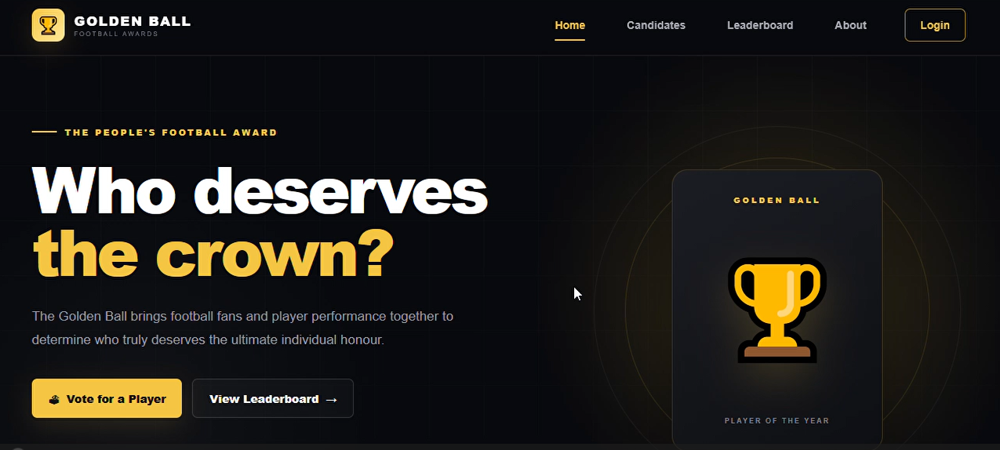
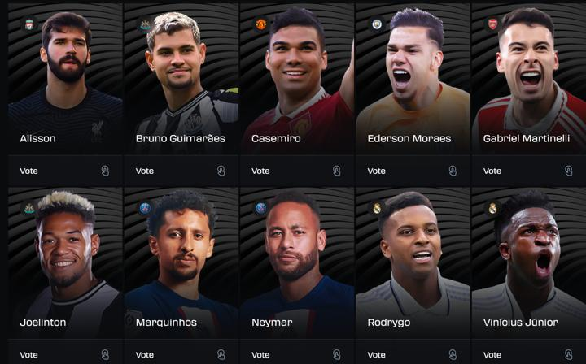
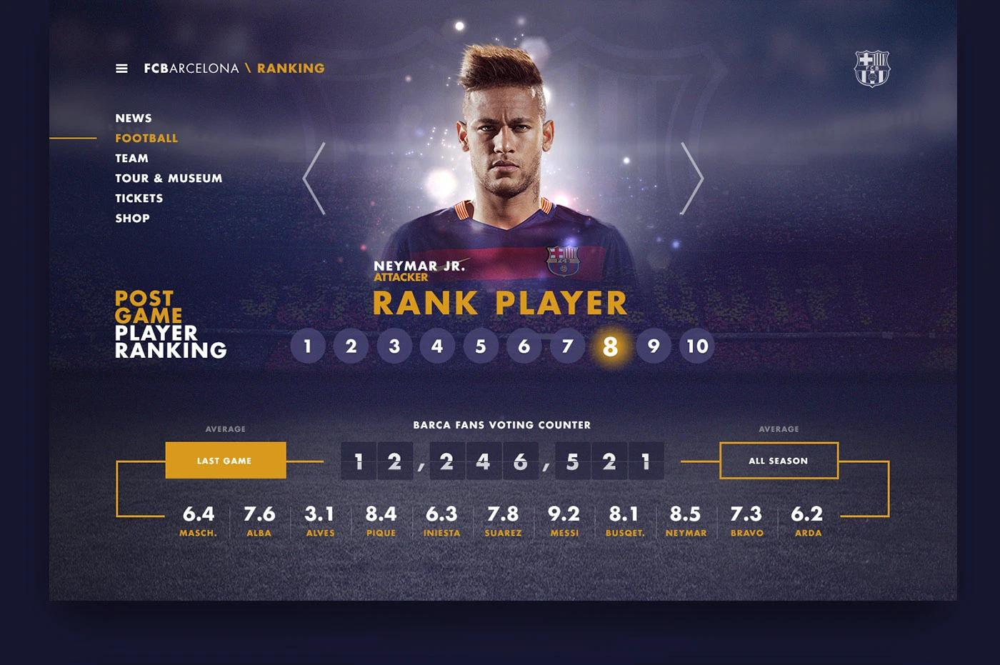

# ⚽ Golden Ball — Online Football Voting Platform

Golden Ball is an online football voting platform inspired by the Ballon d'Or, designed to let football fans participate in player voting and explore candidate rankings.

This repository contains the **frontend only**, built with HTML, CSS, and JavaScript. The backend and API services are maintained separately.

## 📸 Screenshots

Add screenshots of your actual application to the `images/` folder in this repository.

### Home Page



### Player Leaderboard



### Voting Page



> Replace the example filenames with your actual screenshot filenames. GitHub will display the images automatically when the paths match.

## ✨ Features

- **Home Page:** Introduces the platform and its football voting concept.
- **Player Candidates:** Displays eligible football players and their details.
- **Online Voting:** Provides an interface for fans to cast their votes during an active voting period.
- **Leaderboard:** Presents player rankings and voting results.
- **Voting Window:** Supports the display of voting availability based on the backend's voting schedule.
- **Player Statistics:** Supports displaying player performance information retrieved through the backend.
- **Responsive Design:** Designed to provide an accessible interface across supported screen sizes, where implemented.

*The availability of each feature depends on the current frontend implementation and backend integration.*

## 🛠️ Technologies Used

- HTML5
- CSS3
- JavaScript
- REST API integration
- Spring Boot backend (maintained in a separate repository)
- Git and GitHub

## 🏗️ Project Structure

```text
GoldenBall-Frontend/
├── index.html
├── app.js
├── js/
├── styles/
├── html-pages/
├── images/
│   ├── home-page.png
│   ├── leaderboard.png
│   └── voting-page.png
└── README.md
```

Adjust the filenames and folders to match your actual project.

## 🚀 Getting Started

### Prerequisites

- A modern web browser.
- A code editor such as Visual Studio Code or NetBeans.
- The Golden Ball backend running and accessible for features that require API data.

### Installation

1. Clone this repository:

   ```bash
   git clone https://github.com/funwi6191/Golden-Ball.git
   ```

2. Open the downloaded project folder.

3. Open `index.html` in your browser, or run the project using a local development server.

4. Configure the frontend API base URL to point to your running backend, where required.

5. Ensure the backend is running and that its API endpoints are accessible.

**Note:** Some features, including authentication, submitting votes, loading player data, and displaying live leaderboard results, require a working backend. Opening the HTML file alone will not provide these services.

## 🗳️ Voting and Scoring Concept

The planned voting model combines fan participation with football performance statistics:

- **Fan votes:** 30% of the final score.
- **Player statistics:** 70% of the final score.

The backend is responsible for processing votes, obtaining or updating player statistics, and calculating final scores.

## 🔌 Backend Integration

The frontend communicates with the Golden Ball backend through REST API endpoints.

The backend handles functionality such as:

- User authentication and authorization.
- Candidate information.
- Voting eligibility and voting windows.
- Vote submission and duplicate-vote prevention.
- Player statistics and final score calculations.
- Leaderboard data.

The backend is not included in this repository. The frontend must be configured to use an accessible backend API for these features to work.

## 🔒 Security

- Never commit passwords, JWT secrets, database credentials, or private API keys.
- Do not rely on frontend validation alone to enforce voting rules.
- Authentication, authorization, and duplicate-vote prevention must be enforced by the backend.
- Use HTTPS when communicating with a deployed backend.

## 🎯 Project Goal

Golden Ball aims to provide football fans with an accessible voting experience while combining fan participation with measurable player performance statistics.

## 👨‍💻 Author

**Funwi Checy**

- GitHub: [@funwi6191](https://github.com/funwi6191)
- LinkedIn: [My LinkedIn profile](https://www.linkedin.com/in/funwi-checy-4737a3323?utm_source=share_via&utm_content=profile&utm_medium=member_android)

## 📄 License

No license has been specified yet.
